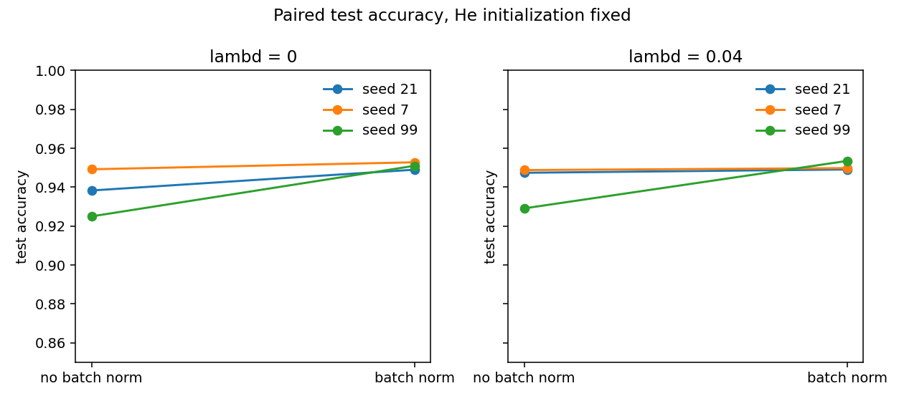
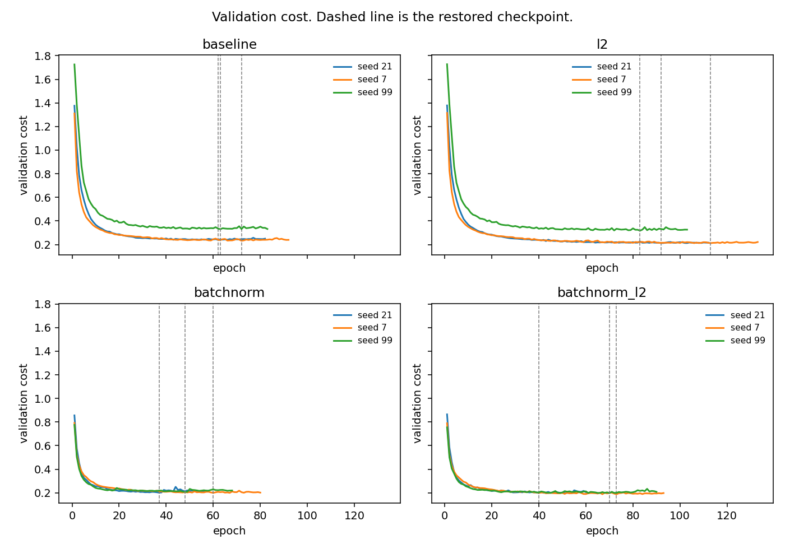

# Neural Network from Scratch on MNIST

A multilayer neural network for handwritten-digit classification with hand-written forward pass, backpropagation, batch-norm gradients and L2 regularization, evaluated in a controlled, multi-seed ablation.

## Why I built this

Before relying on high-level frameworks for computer vision work, I wanted to show that I understand what happens inside them. A data scientist who can derive and debug backpropagation can reason about why a model trains badly, not just swap hyperparameters until it works.

The second goal was experimental discipline. It is easy to claim "batch norm improves accuracy" from a single run. I wanted to measure it properly:

- **Change one factor at a time.** An earlier version of this experiment changed weight initialization together with batch norm, so the comparison mixed two effects. The controlled rerun fixes He initialization on every variant, so only batch norm and L2 vary.
- **Use several seeds and paired comparisons** instead of one lucky run.
- **Lock model selection before looking at the test set.**
- **State honestly what three seeds can and cannot support.**

This is the same rigor I apply to the computer vision work in my face-verification project, here in a setting small enough to verify every gradient by hand.

## Highlights

- **Built from first principles.** Forward pass, backward pass, batch-norm forward/backward, L2 penalty and gradient-descent updates are implemented explicitly. PyTorch is used only for tensors, data loading and gradient checking, not `torch.nn` or an autograd training loop.
- **Controlled 2x2 ablation.** Batch norm (on/off) x L2 (`lambd` 0 / 0.04), with He initialization held fixed on every variant and three seeds (21, 7, 99) per cell: 12 training runs in total.
- **Key result.** Batch norm reached a mean test accuracy of **95.1%** (0.9509) versus **93.8%** (0.9375) for the baseline over three seeds, and cut the seed-to-seed standard deviation from 0.0121 to 0.0019. It was higher on all six paired comparisons.
- **Verified gradients.** The manual backward pass matches PyTorch autograd to about `1e-7` across both initializations and all four batch-norm/L2 combinations, and is also checked against finite differences for the non-batch-norm cases.
- **Leak-free model selection.** Checkpoints are selected on validation cost and written to a hash-locked selection file before any test prediction is computed.
- **Tested and reproducible.** A pytest suite (14 tests) covers shapes, the train/validation split, gradient checks, initialization, the L2 term, batch-norm train/eval behavior, checkpoint selection and seed reproducibility. Versions are pinned and runs resume from signed checkpoints.

## Results



*Test accuracy for each seed, without and with batch norm, at both L2 settings. Each line connects runs that share a seed and initial weights.*



*Validation cost per epoch. Dashed lines mark the restored checkpoint (first minimum of validation cost).*

Test accuracy on the official 10,000-image MNIST test set, after restoring the validation-selected checkpoint (mean and sample SD over 3 seeds, He initialization on every variant):

| Variant | Test accuracy (mean) | Test SD | Val accuracy (mean) |
| --- | ---: | ---: | ---: |
| Baseline | 0.9375 | 0.0121 | 0.9325 |
| L2 (`lambd=0.04`) | 0.9418 | 0.0110 | 0.9357 |
| Batch norm | **0.9509** | 0.0019 | 0.9456 |
| Batch norm + L2 | 0.9508 | 0.0024 | 0.9476 |

Three seeds on one split is a small sample: the gap is consistent in direction but its size is uncertain (see [Limitations](#limitations)).

## Repository structure

```
.
├── main.py                  # Network: init, forward/backward, batch norm, L2, training loop, gradient check
├── run_controlled.py        # Controlled He ablation: 4 variants x 3 seeds, selection lock, test evaluation
├── plot_controlled.py       # Figures and diagnostics from results/controlled_runs.json
├── experiments.ipynb        # Executed notebook: legacy experiment plus a read-only view of the controlled results
├── tests/                   # pytest suite (synthetic data, no MNIST download)
├── results/
│   ├── controlled_summary.md          # Primary results: per-seed, aggregate and paired tables
│   ├── controlled_runs.json / .csv    # Full histories and metrics for the 12 controlled runs
│   ├── controlled_he_v1_selection_lock.json  # Checkpoint selection, written before test evaluation
│   ├── controlled_diagnostics.md      # Cost components and weight norms
│   ├── legacy_mnist_summary.md        # Earlier, confounded experiment (kept for the record)
│   ├── gradient_check_*.json          # Gradient-check records
│   ├── experiment_manifest.json
│   └── figures/                       # Plots used in this README and more
├── requirements.txt         # Pinned runtime dependencies (CPU wheels)
├── requirements-dev.txt     # pytest
└── pytest.ini
```

## How to run

From this directory, on CPU:

```bash
python -m pip install -r requirements.txt
python -m pip install -r requirements-dev.txt
python -m pytest                        # synthetic tests, no download, no training
python run_controlled.py --smoke-test   # a few steps on synthetic data
python run_controlled.py                # full controlled ablation (12 runs)
python plot_controlled.py               # regenerate figures
jupyter notebook experiments.ipynb
```

- `requirements.txt` pins the CPU wheels used for the MNIST runs. `requirements-dev.txt` pins pytest.
- `python -m pytest` does not download MNIST or train.
- `--smoke-test` writes `results/smoke_test.json` with `official_mnist: false`. It is a pipeline check, not a result.
- `python run_controlled.py` resumes from `checkpoints/controlled_he_v1/` when the config and the normalized `main.py` hash match. It will not load a checkpoint whose signature differs, and it does not write the legacy files `checkpoints/{variant}_seed{seed}.pt`.
- Importing `main.py` does not download or train. The first call to `load_mnist` downloads MNIST into `data/` if it is not already there.
- The notebook's last section only reads `results/controlled_summary.md`; opening the notebook does not start the twelve runs.

## Methodology details

### Data

`load_mnist` reads the official MNIST training and test splits through `torchvision.datasets.MNIST`. Validation is a seeded 20% holdout of the training split (split seed 21): 48,000 fit rows and 12,000 validation rows. The official 10,000-row test split is not used to build the holdout.

Every variant scales pixels with `pixel / 255` and flattens 28x28 images to 784 features. Labels are one-hot over 10 classes. Matrices are stored as `(features, examples)`.

Split seed 21 draws the partition once. Seeds 21, 7 and 99 each seed weight initialization and the minibatch permutation; they do not redraw the split. The same seed produces the same initial `W` and `b` for the batch-norm and non-batch-norm variants. Batch-norm `gamma` starts at ones and `beta` at zeros.

### Model

Layer widths are `[784, 20, 7, 5, 10]`. Each hidden layer is an affine map, a ReLU and, when enabled, batch norm after the ReLU. The output layer is an affine map followed by softmax. Batch norm was not moved before the ReLU, and no affine-then-batch-norm-then-ReLU ablation was run.

Initialization is an explicit argument: `legacy_fan_in` (`randn / fan_in`) or `he` (`randn * sqrt(2 / fan_in)`). It is independent of `use_bnorm`. The controlled runs pass `he` for all four variants. If the argument is omitted, the historical default is `legacy_fan_in` for both settings.

Batch-norm statistics are the mean and variance across the batch; scale and shift are learned. Running mean and variance are updated during training when the batch has at least two rows, and are used at evaluation, including accuracy. A training batch of size 1 uses the running statistics and does not update them.

### Training

The loss is mean cross-entropy. If `lambd > 0`, the cost adds `lambd / (2m) * ||W||^2` and the weight gradient adds `(lambd / m) * W`, where `m` is the column count of that call. A minibatch (`m` near 64) and the full validation set (`m = 12000`) therefore do not apply the same penalty to the same weights. On the restored checkpoints the minibatch penalty is about 187 times the validation penalty. Early stopping still uses the sum; that scaling was not changed.

Updates are plain gradient descent: `parameter - learning_rate * gradient`.

Controlled configuration, held fixed across the four variants:

| Setting | Value |
| --- | --- |
| Initialization | `he` for every variant |
| Variants | baseline; L2 `lambd=0.04`; batch norm; batch norm + L2 |
| Learning rate | 0.009 |
| Batch size | 64 |
| Max epochs | 300 |
| Patience | 20 epochs without a lower validation cost |
| Checkpoint | first minimum of validation cost |
| Device | CPU |
| Torch | `2.14.1+cpu` (CUDA unavailable) |

The learning rate, lambda, architecture, split, batch size and patience match the earlier legacy experiment, so those choices were not blind to the MNIST test set. In the controlled experiment, checkpoints were selected on validation cost before any test prediction for these runs was computed. The selection lock is `results/controlled_he_v1_selection_lock.json` (SHA-256 `1cb2d7e27936355edf0b4d9e8b5e59373592eda5483ffb2d0bcdf0fd50b9ffdf`) and contains no test accuracy.

### Controlled results

Test accuracy is `correct / 10000` after restoring the validation checkpoint. Means and sample standard deviations use divisor n-1 over three seeds. Full histories are in `results/controlled_runs.json`; the table below is copied from `results/controlled_summary.md`.

| Variant | Test mean | Test sample SD | Val accuracy mean | Val loss mean |
| --- | ---: | ---: | ---: | ---: |
| Baseline | 0.9375 | 0.0121 | 0.9325 | 0.267556 |
| L2 (`lambd=0.04`) | 0.9418 | 0.0110 | 0.9357 | 0.247721 |
| Batch norm | 0.9509 | 0.0019 | 0.9456 | 0.203599 |
| Batch norm + L2 | 0.9508 | 0.0024 | 0.9476 | 0.194608 |

Per-seed test counts (seeds 21, 7, 99 in that order): baseline 9383, 9492, 9250; L2 9474, 9488, 9291; batch norm 9490, 9528, 9510; batch norm + L2 9491, 9498, 9535.

Paired difference = batch norm minus no batch norm, at the same lambda and seed:

| Lambda | Seed 21 test | Seed 7 test | Seed 99 test | Mean | Sample SD |
| --- | ---: | ---: | ---: | ---: | ---: |
| 0 | 0.0107 | 0.0036 | 0.0260 | 0.0134 | 0.0114 |
| 0.04 | 0.0017 | 0.0010 | 0.0244 | 0.0090 | 0.0133 |

Validation cost was lower for the batch-norm run on all six pairs, and test accuracy was higher on all six pairs. Seed 99 supplies most of the mean test gap, and the sample SD is about as large as the mean. Three seeds on one split do not support a general claim that batch norm is better, or a claim about the size of the gap.

With He fixed, L2 at `lambd=0.04` leaves the batch-norm test mean at 0.9508, against 0.9509 without the penalty. Without batch norm, the three-seed test mean is 0.9418 with L2 and 0.9375 without it. This describes this sample; it is not a tuned lambda, and no lambda grid was run.

Figures in `results/figures/`: paired test accuracies, validation curves, validation cross-entropy and L2 term, restored epochs, weight norms, and test confusion matrices for each seed. The confusion matrices were drawn after checkpoint selection and were not used to choose epochs.

### Legacy experiment

`results/legacy_mnist_summary.md` keeps the original numbers from an earlier version of this project. In those runs the batch-norm variants used He scaling and the other variants used `randn / fan_in`, so the old gap mixes normalization with initialization. That confound is why the controlled ablation above was run.

| Variant | Seed 21 test | Test mean | Test sample SD | Val mean |
| --- | ---: | ---: | ---: | ---: |
| Baseline | 0.9420 | 0.9332 | 0.0092 | 0.9295 |
| L2 (`lambd=0.04`) | 0.9464 | 0.9349 | 0.0117 | 0.9299 |
| Batch norm | 0.9490 | 0.9509 | 0.0019 | 0.9456 |
| Batch norm + L2 | 0.9491 | 0.9508 | 0.0024 | 0.9476 |

The controlled batch-norm test counts match this legacy table, as expected, since those legacy runs already used He. The non-batch-norm conditions do not match, because the controlled runs use He there too. Seed 21 baseline test accuracy is 0.9383 under He and was 0.9420 under fan-in scaling. A legacy-versus-He factorial was not run.

### Gradient check

`check_gradients(seed=0)` compares the manual backward pass to autograd on 6 examples and layers `[5, 4, 3]`. It is run for both initializations and for all four combinations of batch norm and L2. On torch `2.14.1+cpu` the largest autograd gap is about `1e-7`.

Finite differences use step `1e-4` when batch norm is off. The fan-in cases stay under `2e-4`. The He + L2 case reaches `2.17e-4`, which is inside a `3e-4` bound for that larger scale; a smaller step made the float32 gap worse, so the step was not reduced. Records: `results/gradient_check_phase0.json` (before initialization was decoupled from batch norm) and `results/gradient_check_decoupled.json`.

A small gradient gap means the backward formulas agree with autograd on that fixture; it says nothing about MNIST test accuracy. Test accuracy is measured only after a validation checkpoint is locked, on the official 10,000-row split.

### Limitations

- Three initialization seeds and one split are a small sample.
- The widths, learning rate and lambda were not searched for this comparison.
- The validation L2 term is on a different scale from the minibatch L2 term.
- The protocol was already used in the legacy experiment, which had seen the test set.

## Author

Dor Meir
